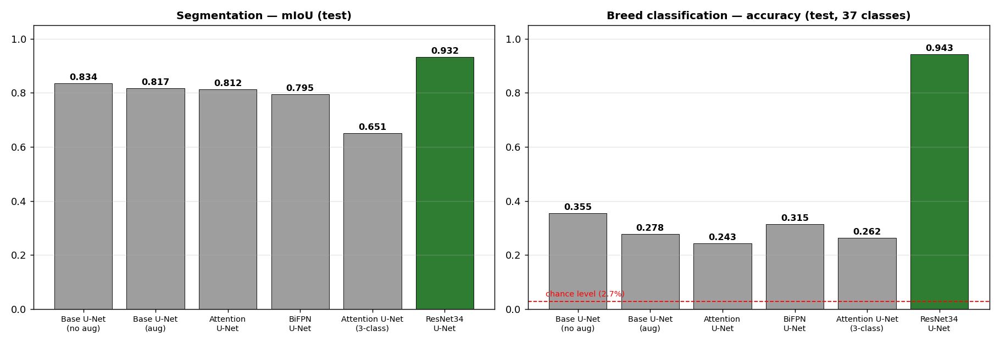
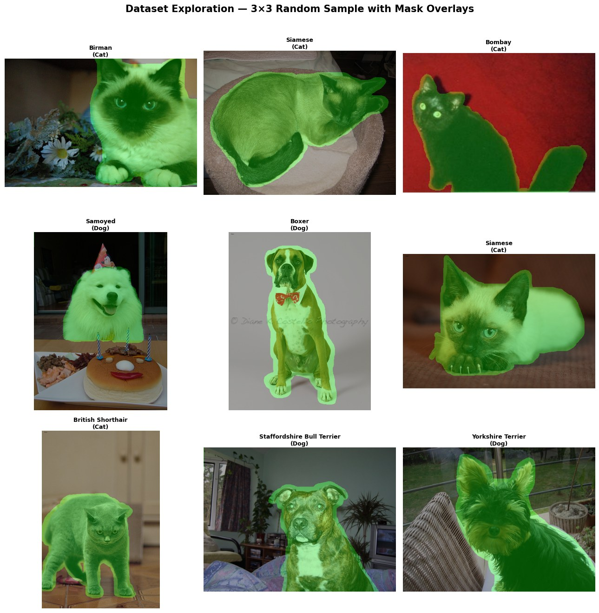
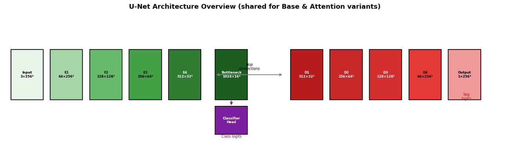
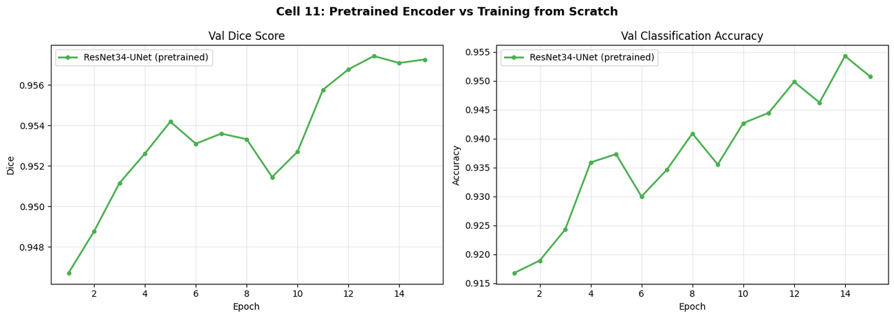
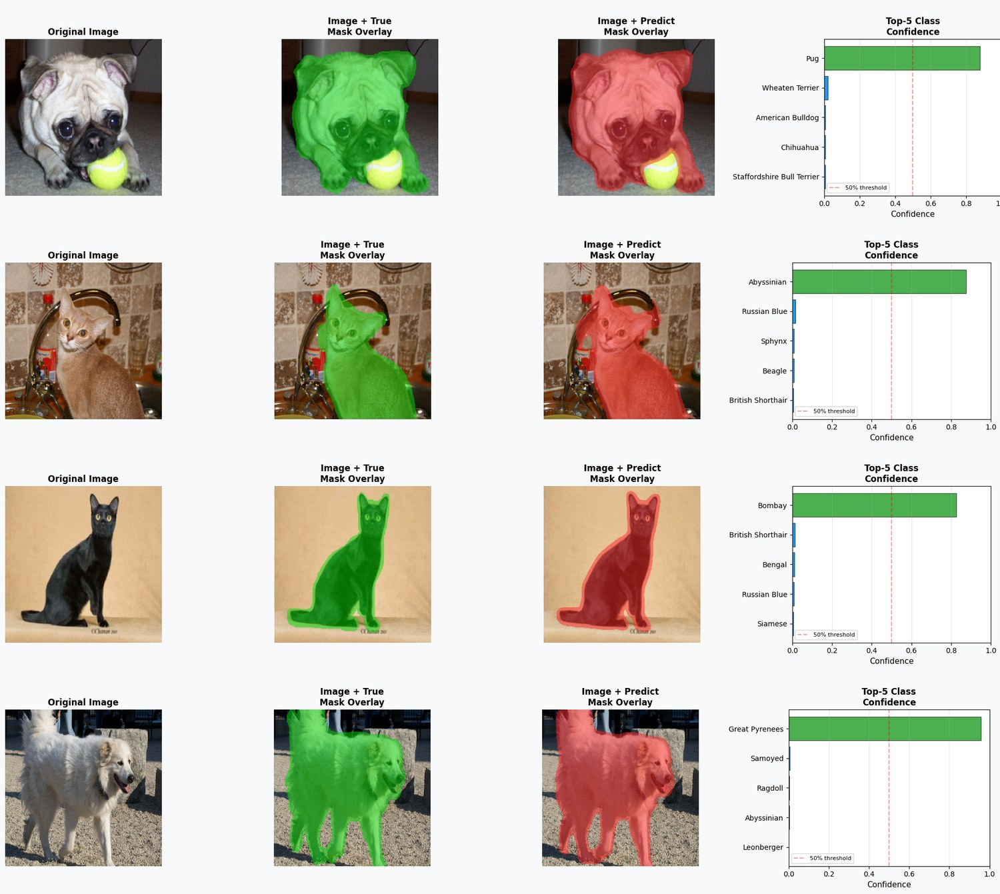

# Pet Segmentation & Breed Classification (U-Net, Attention U-Net, BiFPN, ResNet34-UNet)

A PyTorch multi-task pipeline that **segments the pet** and **classifies its breed (37 classes)** in a single forward pass, trained and benchmarked on the Oxford-IIIT Pet Dataset. Four encoder–decoder variants are compared against each other: Base U-Net, Attention U-Net, an EfficientDet-style BiFPN decoder, and a U-Net with an ImageNet-pretrained ResNet34 encoder. Built for **CSE428 — Image Processing** at BRAC University.



## Headline Results (held-out test set, 1,109 images)

| Model | Seg. mIoU | Pixel Acc. | Breed Acc. | Breed Macro-F1 |
|---|---|---|---|---|
| Base U-Net (scratch, no aug) | 0.8342 | 0.9116 | 0.3553 | 0.3337 |
| Base U-Net (scratch, aug) | 0.8171 | 0.9015 | 0.2777 | 0.2495 |
| Attention U-Net (scratch, aug) | 0.8119 | 0.8981 | 0.2426 | 0.2141 |
| EfficientDet-style BiFPN U-Net (scratch, aug) | 0.7949 | 0.8872 | 0.3147 | 0.2906 |
| Attention U-Net, 3-class seg. (scratch, aug) | 0.6510 | 0.8510 | 0.2624 | 0.2435 |
| **ResNet34 U-Net (ImageNet-pretrained encoder)** | **0.9317** | **0.9655** | **0.9432** | **0.9431** |

**Takeaway:** swapping the from-scratch encoder for a pretrained ResNet34 raised breed accuracy from ~24–36% to **94.3%** and segmentation mIoU from ~0.79–0.83 to **0.93**, with a 15-epoch run of ~19 minutes on 2× Tesla T4. On ~5k training images and 37 classes, *transfer learning mattered far more than the decoder architecture* — attention gates and a BiFPN decoder did not beat a plain U-Net in this setup (10 epochs, single seed).

Full per-split (train / val / test) metrics: [`results/scratch_models_all_splits.csv`](results/scratch_models_all_splits.csv) · [`results/resnet34_unet_test.csv`](results/resnet34_unet_test.csv)

## Problem

Given a pet photo, produce (1) a pixel-level foreground mask of the animal and (2) its breed among 37 cat/dog breeds. Segmentation and classification share one encoder: a classifier head is attached to the encoder bottleneck and **both tasks are trained jointly** with a combined loss, so the shared features serve both objectives.

## Dataset

[Oxford-IIIT Pet Dataset](https://www.robots.ox.ac.uk/~vgg/data/pets/) (Parkhi et al., CVPR 2012) — 7,390 image/trimap pairs as loaded from the Kaggle mirror, 37 breeds (2,400 cat / 4,990 dog images).

- **Mask handling:** trimaps encode 1 = pet, 2 = background, 3 = unclassified/boundary. Boundary pixels are merged into the foreground for binary segmentation; a 3-class variant keeps them separate.
- **Split:** stratified by breed, 70 / 15 / 15 → **5,173 train / 1,108 val / 1,109 test**, seed 42.
- **Input:** 256×256, ImageNet mean/std normalisation.



## Approach

1. **Exploration** — class distribution, mask pixel statistics, 3×3 random image + mask overlay grid.
2. **Data pipeline** — custom `Dataset` returning image, breed label, binary mask and 3-class mask; Albumentations augmentation (random crop, flip, shift/scale/rotate, colour jitter, blur, grid distortion, coarse dropout).
3. **Models** (shared joint segmentation + classification design)
   - **Base U-Net** — 4-level encoder/decoder, skip connections, 31.7M parameters
   - **Attention U-Net** — attention gates on every skip connection (Oktay et al.), 32.1M parameters
   - **EfficientDet-style BiFPN U-Net** — BiFPN decoder with fast-normalised weighted fusion (top-down + bottom-up paths), 21.1M parameters
   - **ResNet34 U-Net** — ImageNet-pretrained encoder, U-Net decoder, differential learning rates (encoder 10× lower)
4. **Training engine** — AdamW, cosine annealing with warm restarts, mixed precision (AMP), gradient clipping, best-checkpoint selection on validation Dice. Binary segmentation loss = BCE + Dice + 0.5·Focal (cross-entropy for the 3-class variant); classification loss = cross-entropy with label smoothing (0.1).
5. **Evaluation** — mIoU, Dice, pixel accuracy (segmentation); accuracy, macro precision / recall / F1 (classification); reported on train, validation and test sets.
6. **Live demo function** — takes any test index and renders *original · true-mask overlay · predicted-mask overlay · top-5 breed confidences*, with per-image IoU.



## Experiments

### Required: U-Net vs. Attention U-Net
Both trained 10 epochs with augmentation, joint classification head. Attention gates did **not** improve on the base model here (test mIoU 0.8119 vs 0.8171); both from-scratch models are still clearly under-trained for the 37-way classification task (24–28% accuracy vs. 2.7% chance).

### Extension experiments
| Experiment | Finding |
|---|---|
| **Augmentation on/off** (Base U-Net) | Over 10 epochs augmentation *slowed* convergence (test mIoU 0.8171 aug vs 0.8342 no-aug; breed acc. 0.278 vs 0.355). Regularisation benefits typically appear with longer schedules — see Limitations. |
| **3-class segmentation** (Attention U-Net) | Keeping the boundary band as its own class lowers mIoU to 0.651 — the thin, ambiguous boundary class is genuinely hard to predict. |
| **EfficientDet-style BiFPN decoder** | Best from-scratch *augmented* classifier (0.315 acc.) with 33% fewer parameters than Base U-Net, but lower segmentation mIoU (0.795). |
| **Pretrained classifiers** (MobileNetV2 / EfficientNet-B0 / DenseNet-121, 5 epochs, standalone) | 91.6% / 92.5% / **93.0%** test accuracy — i.e. pretrained features reach >91% within 5 epochs, versus ≤36% for the from-scratch joint models after 10 epochs (different training setups, so indicative rather than a controlled comparison). See [`results/pretrained_classifier_comparison.csv`](results/pretrained_classifier_comparison.csv). |
| **Hyper-parameter search** (3 optimizers × 3 learning rates, 1-epoch probe) | Adam @ 3e-4 gave the highest probe validation Dice; SGD lagged badly at this budget. See [`results/hyperparameter_search_1epoch_probe.csv`](results/hyperparameter_search_1epoch_probe.csv). |



### Example predictions (ResNet34 U-Net, test set)

| Test index | True breed | Predicted breed | Mask IoU | Confidence |
|---|---|---|---|---|
| 663 | Pug | Pug ✓ | 94.4% | 0.878 |
| 98 | Abyssinian | Abyssinian ✓ | 88.9% | 0.877 |
| 148 | Bombay | Bombay ✓ | 95.0% | 0.828 |
| 10 | Great Pyrenees | Great Pyrenees ✓ | 96.0% | 0.958 |



More examples: [`images/demo/`](images/demo/). Training curves for every run: [`images/`](images/).

## Metric Definitions (read before comparing numbers)

- **mIoU** — mean IoU over {background, foreground} (binary) or {background, foreground, boundary} (3-class). Comparable across all rows above.
- **Dice** — the per-epoch training logs report *foreground-only* Dice; the final summary CSV reports Dice *averaged over classes*; the ResNet34 test Dice (0.9589) is *foreground-only*. Compare models on **mIoU and pixel accuracy**, and compare Dice only within the same definition (see column names in the CSVs).
- **Breed metrics** — accuracy and macro-averaged precision / recall / F1 over 37 classes.

## Limitations & Honest Notes

- **From-scratch models are under-trained** (10 epochs; ~18–21 min each). Their classification scores say more about the training budget than about the architectures. A longer schedule (30–50 epochs) is the first thing to try.
- **Single seed, no confidence intervals** — differences of ~1 mIoU point between from-scratch variants are within plausible run-to-run noise.
- **Train-split metrics in the summary table were computed on the augmented training loader**, so they are not a clean "train" measurement.
- **The hyper-parameter probe is a single epoch**, so its ranking is noisy; the probe's best optimizer (Adam) differs from the AdamW used in the main runs (same learning rate, 3e-4).
- **3-class segmentation was run for Attention U-Net only.**
- **Model weights are not included** (≈85–130 MB each, above GitHub's file limit); retrain with the notebook or publish weights via GitHub Releases / Hugging Face.
- **Fixed after the recorded run:** the demo's *predicted species* label always printed "(cat)" (it was derived from a title-cased breed name). The code now uses a `breed_to_species` lookup; recorded outputs for those cells predate the fix, and the demo images in this README are cropped to exclude that title. Predicted breed, masks, IoU and confidences were never affected. A dead duplicate forward-pass line in `AttentionUNet.forward` was also removed.

## Repository Structure

```
├── notebook/
│   └── cse428_pet_segmentation_classification.ipynb   # full pipeline with recorded outputs
├── results/                                           # metrics as CSV (train/val/test, classifiers, tuning)
├── images/                                            # figures, training curves, demo predictions
├── requirements.txt
├── LICENSE
└── .gitignore
```

## How to Run

The notebook was developed and executed on **Kaggle (2× Tesla T4)**.

1. Download the [Oxford-IIIT Pet Dataset](https://www.robots.ox.ac.uk/~vgg/data/pets/) (images + annotations/trimaps) — or add a Kaggle copy to your notebook.
2. Install dependencies: `pip install -r requirements.txt`
3. Open `notebook/cse428_pet_segmentation_classification.ipynb` and update `images_dir` / `masks_dir` (dataset cell) and the `/kaggle/working` output paths for your environment.
4. Run all cells top to bottom (GPU strongly recommended). In the final demo cell, set `FACULTY_INDICES` (or any test index) to visualise predictions.

## Technical Architecture
- **Language:** Python 3.x
- **Paradigm:** Deep learning — multi-task encoder–decoder (shared encoder, segmentation decoder + classifier head)
- **Frameworks:** PyTorch, torchvision, Albumentations, OpenCV, scikit-learn, pandas, matplotlib
- **Data Storage:** Image files + trimap PNGs; metrics exported as CSV
- **Interface:** Jupyter Notebook (Kaggle GPU environment)

## Core Engineering Practices Demonstrated
- **Multi-Task Learning:** One shared encoder trained jointly for pixel-wise segmentation and 37-way classification with a weighted combined loss.
- **Architecture Implementation from Papers:** U-Net, Attention U-Net (attention gates on skip connections) and a BiFPN decoder with fast-normalised fusion implemented from scratch in PyTorch.
- **Transfer Learning:** ImageNet-pretrained ResNet34 encoder with differential learning rates, lifting breed accuracy from ~24–36% (scratch models) to 94%.
- **Controlled Experimentation:** Augmentation on/off, 3-class vs binary segmentation, pretrained-classifier comparison, and an optimizer × learning-rate sweep, all evaluated on identical stratified splits with a fixed seed.
- **Rigorous Evaluation:** mIoU, Dice, pixel accuracy, and macro precision/recall/F1 reported on train, validation and test sets, with metric definitions documented.
- **Training Engineering:** Mixed precision (AMP), gradient clipping, cosine-annealing warm restarts, label smoothing, best-checkpoint selection, and GPU-memory management for a 2-GPU Kaggle environment.
- **Honest Reporting & Debugging:** Limitations and known issues are documented; a species-label bug found during review was fixed and disclosed rather than hidden.

## Author
**Md. Tanvirul Islam Rifat**
- **GitHub:** [@tanvirul-islam-rifat](https://github.com/tanvirul-islam-rifat)
- **LinkedIn:** [Tanvirul Islam Rifat](https://www.linkedin.com/in/tanvirul-islam-rifat)
